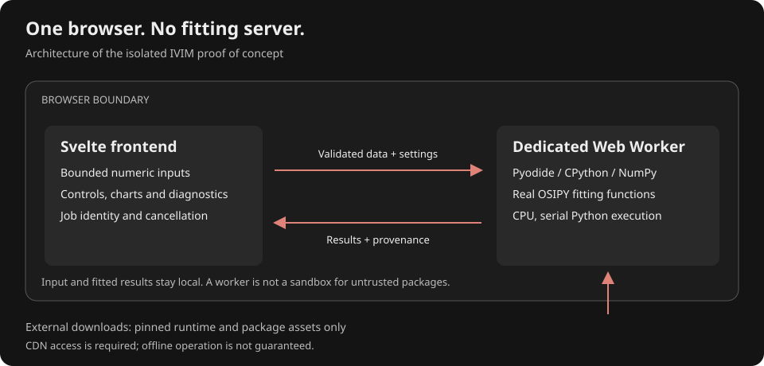
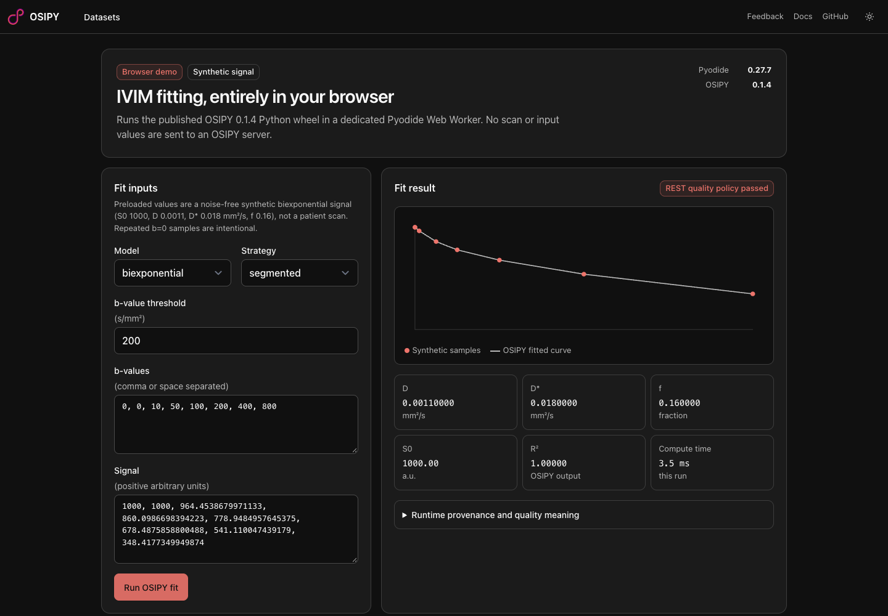

# Bringing research packages into the browser

This guide helps researchers assess, adapt, and validate Python packages for the
OSIPY dashboard. Pyodide runs CPython in WebAssembly; it is not a complete desktop
operating system, a Docker replacement for arbitrary services, or a security
sandbox for untrusted Python.

**Baseline:** our [IVIM demo](browser-ivim-demo.md) uses Pyodide **0.27.7**, Python
**3.12.7**, NumPy **2.0.2**, and OSIPY **0.1.4**. Its six single-voxel fitting
combinations have been exercised in Chromium against native Python fixtures.
Other packages and workflows below are candidates, not verified integrations.
Documentation was consulted on **2026-10-07**. Always check the documentation and
package catalogue for the exact runtime you deploy: `stable` can describe a newer
runtime with different Python, ABI, package versions, and restrictions.

## Architecture and working example



The diagram describes the isolated numeric-signal demo, not an arbitrary-package
execution service. Downloads cross the browser boundary; fitting inputs do not.



Screenshot captured on 2026-10-07 from the isolated `/browser-ivim` demo. It shows
a synthetic single-voxel result, not a patient dataset or a whole-volume benchmark.

## What can run?

There is no permanent exhaustive list of “allowed packages.” Compatibility has
three separate requirements: a loadable build, supported runtime operations, and
acceptable resource use. Successfully importing a package proves only the first
part of its workflow.

| Capability or dependency | Browser status | Researcher action |
| --- | --- | --- |
| Pure Python calculations, classes, dataclasses, validation | Usually suitable | Supply a wheel; inspect every transitive dependency and exercise the real entry point. |
| NumPy arrays, linear algebra, FFTs | Available in this demo runtime | Use the runtime's compatible build; validate dtype, precision, layout, and numerical results. |
| Other catalogue packages, e.g. SciPy, Matplotlib | Available where listed for the selected release | Check that release's catalogue and versions; test the specific operations, not just imports. |
| Pure Python wheels from PyPI or a controlled URL | Installable with `micropip` | Pin versions and origins; confirm Python requirements and dependencies. |
| C/C++/Rust/Fortran extensions | Conditional | Obtain or build a compatible Emscripten/WebAssembly wheel and all required native dependencies. Desktop wheels do not work. |
| Ordinary `pathlib`, `open`, temporary files | Work against a virtual filesystem | Bridge selected files into it; return outputs as downloads. Do not assume access to the user's disk. |
| Persistent caches or databases | Conditional | Use an explicit browser storage adapter; handle quota, denial, eviction, and synchronization. |
| HTTP downloads | Conditional | Use browser networking; obey CORS, CSP and HTTPS requirements. Prefer asynchronous `fetch`/`pyfetch`. |
| `asyncio` | Useful for cooperative asynchronous work | It does not make CPU-bound fitting parallel or automatically interruptible. |
| Background computation | Supported through Web Workers | Put Pyodide in a module worker and use typed messages. Workers cannot manipulate the DOM. |
| Python threads, `ThreadPoolExecutor`, multiprocessing | Not working in the pinned runtime | Select a serial execution path or orchestrate independent Web Workers outside Python. |
| `subprocess`, shell commands, native executables | No desktop process execution | Replace the operation with a browser implementation or a separately compiled WASM module. |
| Raw TCP sockets, listening HTTP servers | No ordinary socket support | Remove the server boundary; call functions through the worker bridge. Browser WebSockets are a different API. |
| CUDA/CuPy and native GPU drivers | Not directly supported | Keep a NumPy CPU path. WebGPU would require a separate implementation and validation. |
| Desktop GUI libraries and terminal interaction | Not a browser UI | Use frontend controls and rendering; replace `input()` with explicit configuration. |
| Compressed imaging formats and DICOM pixels | Depends on codecs and package builds | Verify each transfer syntax/codec, scaling, orientation, metadata and decompression limits. |
| Offline operation | Not automatic | Explicitly cache/version every required asset and test a cold offline launch. |

## Standard-library boundaries in Pyodide 0.27.7

Most of Python's standard library works. The official compatibility page lists:

- Optional, separately loaded modules: `ssl`, `lzma`, `sqlite3`, and `test`.
  Loading `ssl` does not grant raw network sockets or desktop certificate control.
- Limited modules: `hashlib` (some algorithms require a separately loaded
  package), `decimal` (the Python implementation is separate), `pydoc`
  (builtin help data is separate), `webbrowser` (browser API stubs), and
  `zoneinfo` (requires timezone data).
- Removed modules: `curses`, `dbm`, `ensurepip`, `fcntl`, `grp`, `idlelib`,
  `lib2to3`, `msvcrt`, `pwd`, `resource`, `syslog`, `termios`, `tkinter`,
  `turtle.py`, `turtledemo`, `venv`, `winreg`, and `winsound`.
- Threading, multiprocessing, and socket functionality are not working.
  `pty` and `tty` cannot be imported because `termios` is absent.

Check the [versioned compatibility page][compatibility] before relying on any
standard-library feature. Do not infer functionality solely from an import.

## Choose the smallest adaptation

1. **Use unchanged Python** when the algorithm and its dependencies already work.
2. **Add boundary adapters** for files, configuration, progress, cancellation,
   exports, and execution scheduling.
3. **Make desktop-only features optional** so an unused native dependency does
   not prevent installing the scientific core.
4. **Cross-compile a dependency** only when the required operation has no suitable
   browser build. Use a toolchain matched to the selected Pyodide ABI.
5. **Port a measured bottleneck to a separate WASM kernel** only when profiling
   justifies the additional implementation and validation burden.

Keep one authoritative scientific implementation where possible. An adapter
must not silently approximate a model, omit observations, average repeated
acquisitions, change units, or substitute a different estimator.

## Package preparation and loading

Inspect `pyproject.toml`, import paths, and transitive dependencies. Look for
native libraries, executable discovery, subprocesses, threading, GPU assumptions,
terminal prompts, filesystem discovery, import-time side effects, and network
calls. A `py3-none-any` wheel can still call unsupported system APIs.

Use `pyodide.loadPackage(...)` for packages provided by the pinned runtime and
`micropip.install(...)` for compatible wheels with dependency resolution. Do not
assume `pip`, source-distribution builds, or arbitrary desktop binary wheels are
available in the browser.

Our existing worker does this:

```javascript
// After loading the pinned Pyodide runtime in a module worker:
await pyodide.loadPackage(['numpy', 'micropip']);
// OSIPY installation and the fitting call are in browser-ivim.worker.ts.
```

The demo installs the published OSIPY wheel with `deps=False` because its tested
numeric IVIM path only requires NumPy; broader package dependencies are not
needed for that path. **This is not a general compatibility fix.** Disabling
dependency resolution neither supplies missing imports nor makes native code
work. For a reusable package, prefer accurately declared optional extras and a
documented browser dependency set.

Record runtime, Python, package, wheel and build-tool versions; asset origins;
hashes; licences; and redistribution obligations. Versioned URLs alone do not
prove integrity. Micropip documents PyPI hash validation, but arbitrary URL
installation needs an explicit integrity policy; the current demo documents its
wheel hash rather than implementing a separate full-asset integrity verifier.
Do not introduce third-party CORS proxies to work around package loading errors.

For native extensions, follow the [Pyodide build documentation][build]. Match
Python and Emscripten ABI tags, supported native libraries, and runtime versions.
A successful cross-compilation still requires browser numerical and resource
testing.

## Frontend-to-Python contract

Use the existing demo as the concrete pattern:

- `src/lib/browser-ivim.ts`: requests, result types, input and output validation.
- `src/lib/browser-ivim.worker.ts`: runtime loading and the real Python call.
- `src/lib/components/BrowserIvimWorkbench.svelte`: controls, lifecycle, and UI.
- `scripts/browser_ivim_native_fixture.py`: native reference generation/checking.
- `scripts/fixtures/browser-ivim-native.json`: numerical reference values.

Send data and settings, **not user-generated Python source**. Pass values through
`pyodide.globals.set`, JSON, or carefully managed array conversion; never splice
user strings into executable code. Include a job identifier and ignore stale
responses. Serialize calls sharing one interpreter; concurrent messages must
not overwrite its globals.

Validate shapes, lengths, dtypes, finite values, units, parameter domains and
size limits before computation. Validate results before display. Distinguish
missing estimates, convergence, bound hits, and post-fit quality policy. Do not
turn failure into a plausible-looking zero or a “valid” result.

Return actual software versions, effective settings, input identity, execution
time and diagnostics. Keep fitted predictions separate from raw observations.

## Files, memory, and responsiveness

The default filesystem is in-memory **MEMFS** and disappears with the runtime.
`Path('/data/...')` addresses this filesystem, not a user's desktop directory.
Use selected `File`/`Blob` inputs, safe generated paths, bounded decompression and
explicit downloads. Directory access requires browser support and user-granted
permissions; do not make it a prerequisite when file selection is sufficient.

Persistent storage requires explicit synchronization and failure handling.
For this dashboard, keep scans and subject metadata session-local; imaging arrays
must not enter localStorage. Runtime-asset caching and research-data persistence
are different decisions.

Budget for the runtime, original file, decompressed image, typed arrays, NumPy
conversion, masks, working buffers and output maps. Transferring an `ArrayBuffer`
between workers can avoid a message copy but does not guarantee zero-copy access
from NumPy; it also detaches the sender's buffer. Document ownership and release
Python/JavaScript proxies when used (`PyProxy.destroy()`).

Process bounded batches. Check whether chunking happens **before** extracting or
copying all selected voxels: chunking the optimizer alone may not bound memory.
Do not promise a universal image-size ceiling or native-like speed; measure on
the target browsers and lower-memory devices.

`runPythonAsync` is not a guarantee that CPU-heavy code yields to the UI. A worker
keeps the main thread responsive, but a cancel message cannot interrupt a blocked
worker by itself. The demo uses `worker.terminate()` and restarts cold. Graceful
Pyodide interrupts require a shared interrupt buffer and appropriate
cross-origin isolation; long native operations must also cooperate with signal
checks. Do not assume those headers are available on the current static host.

## Security and privacy

Treat packages as executable code. Python can access JavaScript and browser
networking; a worker is not a security boundary for a malicious package. Review
package provenance and side effects before integrating it. Do not expose an
arbitrary upload-and-execute plugin facility as part of this research guide.

Use HTTPS, controlled package origins, compatible CSP, pinned assets and an
integrity policy. Do not store credentials in Python globals shared with
untrusted code, URLs, logs, exports or localStorage. Do not print scan metadata in
diagnostic logs.

“Runs locally” does not mean “makes no network requests.” Disclose runtime/package
downloads and verify that no inputs or outputs are uploaded. Test with network
inspection, including failure paths; do not claim privacy solely because the
UI has no upload button.

## Evidence required for a new integration

- [ ] Identify the exact scientific operation, supported inputs, methods and
  exclusions; label synthetic examples and research-only status.
- [ ] Pin a compatible runtime and dependency set; record origins, hashes and
  licences, including transitive/native dependencies.
- [ ] Run the real package entry point in a production-base browser build;
  imports, a mock result, or native-only tests are not sufficient.
- [ ] Compare identical inputs and effective settings against native Python,
  with justified tolerances. Include noisy data, repeated samples, edge cases,
  failures, and precision checks—not only a clean synthetic signal.
- [ ] Test validation, diagnostics, cancellation, retries, stale responses and
  runtime cleanup; verify that invalid estimates stay explicitly unavailable.
- [ ] Measure cold download/startup, warm computation and peak resource use;
  test representative ROI/volume sizes before claiming whole-volume support.
- [ ] Check desktop/mobile accessibility, internal scrolling, unsupported-browser
  behavior, package loading errors and denied storage.
- [ ] Inspect network traffic; establish and document privacy, caching and any
  offline guarantees separately.
- [ ] Document the validation actually performed, browser versions and remaining
  limits. Run or modify automated tests only when explicitly requested; do not
  describe unperformed checks as passing.

## OSIPY adaptation map

| Area | Current evidence | Next work |
| --- | --- | --- |
| IVIM numeric fitting | Six combinations verified for one synthetic voxel in the demo | Noisy/degenerate data, ROI and volume performance, richer diagnostics. |
| DCE, DSC, ASL scientific modules | Source inspection suggests predominantly Python/NumPy | Exercise real entry points and validate each method; not yet browser-certified. |
| Backend dispatch | Demo calls Python directly in a worker; current main also contains a browser analysis client for the viewer | Consult `frontend/src/lib/browser-analysis-client.svelte.ts` for viewer integration; the historical demo checks above do not verify that newer integration. |
| CPU/GPU configuration | Demo explicitly selects CPU and one Python worker | Browser-level scheduling only if measurement justifies it. |
| NIfTI, BIDS and DICOM I/O | Existing browser viewer already has some local import/export paths | Assess OSIPY I/O dependency builds and codecs independently. |
| `dcm2niix` | Existing wrapper launches a native subprocess | A separately validated WASM converter or explicit unsupported capability; no conversion in this demo. |
| Plotting and terminal prompts | Existing frontend can own UI concerns | Keep Python results/validation; adapt interaction instead of emulating a desktop. |
| CuPy/CUDA | Not available through the demo | Maintain CPU support; treat WebGPU as a separate research project. |

## Official references

- [Compatibility and standard-library constraints for 0.27.7][compatibility]
- [Loading packages for 0.27.7](https://pyodide.org/en/0.27.7/usage/loading-packages.html)
- [Package catalogue for 0.27.7](https://pyodide.org/en/0.27.7/usage/packages-in-pyodide.html)
- [Web Workers for 0.27.7](https://pyodide.org/en/0.27.7/usage/webworker.html)
- [Filesystem for 0.27.7](https://pyodide.org/en/0.27.7/usage/file-system.html)
- [JavaScript/Python conversions](https://pyodide.org/en/0.27.7/usage/type-conversions.html)
- [Interrupts for 0.27.7](https://pyodide.org/en/0.27.7/usage/keyboard-interrupts.html)
- [Building packages][build] (match its toolchain guidance to your chosen runtime)
- [Current stable documentation](https://pyodide.org/en/stable/) (not the demo's pinned baseline)

[compatibility]: https://pyodide.org/en/0.27.7/usage/wasm-constraints.html
[build]: https://pyodide-build.readthedocs.io/en/latest/
