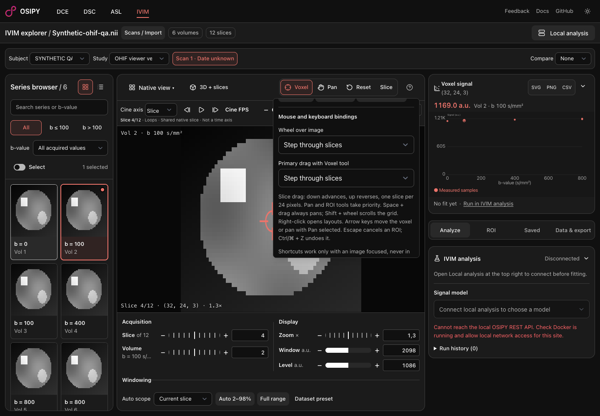
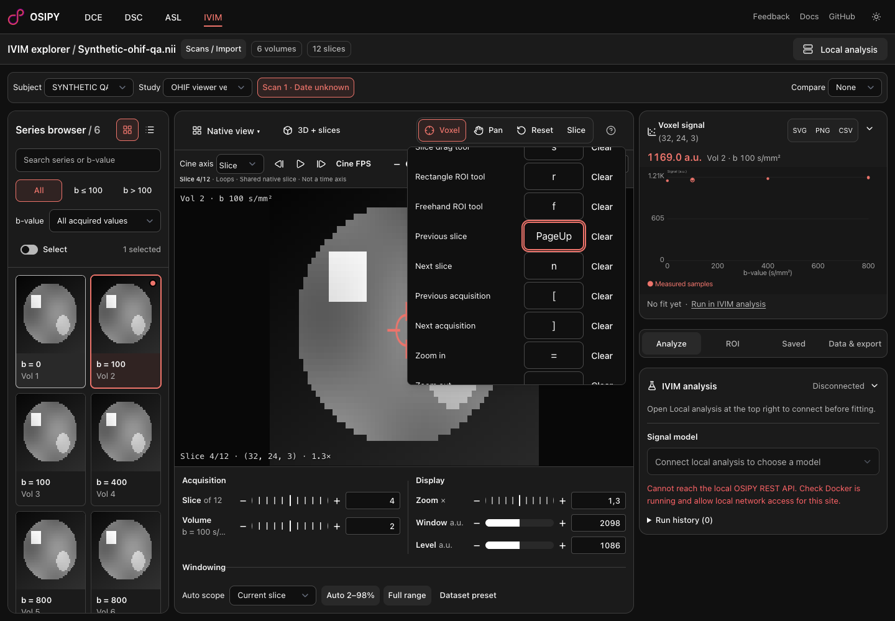
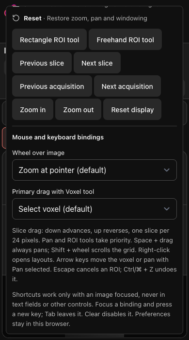

# OHIF-01 / OHIF-08: mouse and keyboard bindings

Related to #23 and #15. This PR is stacked on the cine PR because both extend the same viewer controls. Screenshots show synthetic, non-patient geometry (see the OHIF-07 receipt).

## Executed acceptance

Configured headless Playwright MCP against local Vite:

- The existing default wheel gesture zooms at the pointer; default PageDown advances the slice.
- Opting into wheel slice navigation moves through native slices. A 48-pixel primary drag advances two slices when that binding is selected.
- Rebinding Next slice to `n` works with image focus. A duplicate `n` binding and reserved ArrowDown binding are rejected.
- Typing in the series search field does not navigate the image.
- Wheel choice and the rebound shortcut survive a real page reload.
- At 390 × 700, preference controls and the reset action remain reachable by internal scrolling, without document overflow. Reset restores default bindings.
- Reviewed editable/composition/modifier guards, gesture cancellation and finite slice clamping. Existing ROI-priority and temporary Space-pan paths remain intact in the diff.

## Finalization

`bun run check` (zero diagnostics), `bun run build`, focused changed-file Prettier/ESLint, and `bun test scripts/workspace.test.ts scripts/ivim.test.ts scripts/roi-registration.test.ts scripts/layout-preferences.test.ts` all passed (18 tests). Integration removed a duplicate route callback introduced when combining the two independent worker patches. Build warnings are nonfatal Node deprecation / chunk size; the optional analysis backend was not started.

