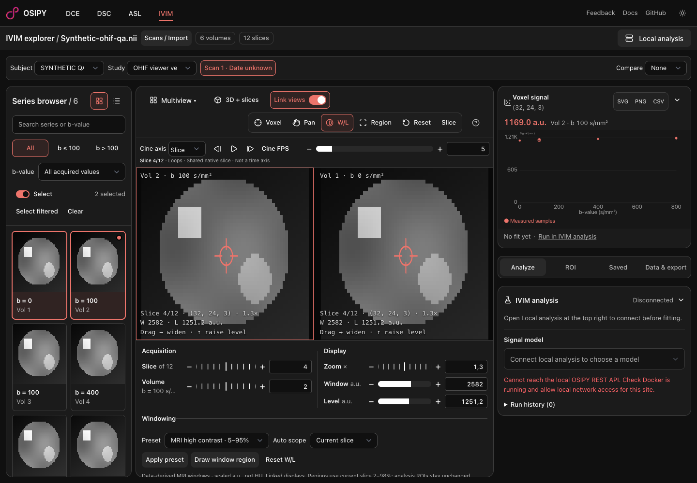
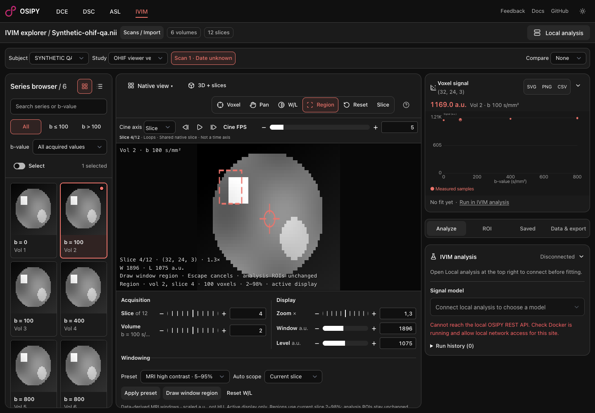
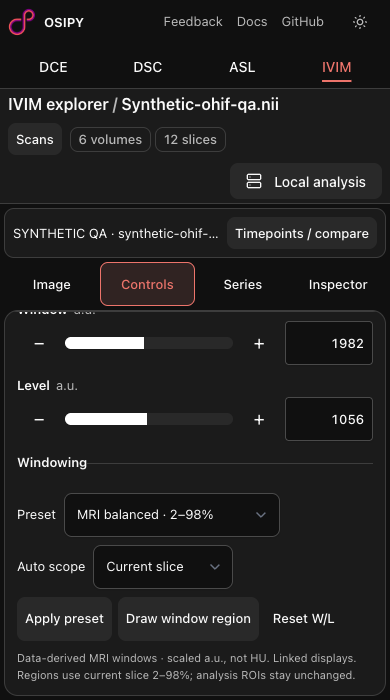

# OHIF-02 / OHIF-03: MRI windowing

Related to #23. Stacked on the input/shortcuts PR: W/L and regional windowing participate in its tool and gesture handling, including configurable `w` / `e` shortcuts. Screenshots use synthetic geometry, not patient data (fixture described in the OHIF-07 receipt).

## Executed acceptance

Configured headless Playwright MCP against local Vite:

- Dragging right/up changed width/level from 2098/1086 to 2439.1/1262.2. Numerical controls reflect the actual image display.
- Applying the high-contrast MRI preset changed the display; Reset W/L restored the dataset window exactly. Presets are data-derived percentiles, not CT/HU or invented tissue-specific constants.
- Drawing a native 10 × 10 region on acquisition 2, zero-based slice 3 selected 100 voxel centers and produced W=1896, L=1075. An independent read of the NIfTI bytes verified its exact scaled 2nd/98th percentiles (127/2023).
- In two-pane mode, unlinked dragging changed only the active display. Linked dragging updated both panes to W=2582, L=1251.2.
- On 390 × 700, the full-range preset applies from the internally scrolling Controls pane without document overflow. Mobile Controls hides image-only chrome/cine controls to preserve usable editing space; cine remains available in Image and pauses when hidden.
- Regional window rectangles have separate state from analysis ROIs. Native samples are read without mutation. Diff review covered clipping, finite bounds, gesture cancellation and local-only handling.

## Finalization

After integration/mobile changes: `bun run check` (zero diagnostics), `bun run build`, focused changed-file Prettier/ESLint and `bun test scripts/workspace.test.ts scripts/ivim.test.ts scripts/local-import.test.ts scripts/roi-registration.test.ts` passed (23 tests). Build retains nonfatal Node deprecation and large-chunk warnings. No backend required for these viewing features.

