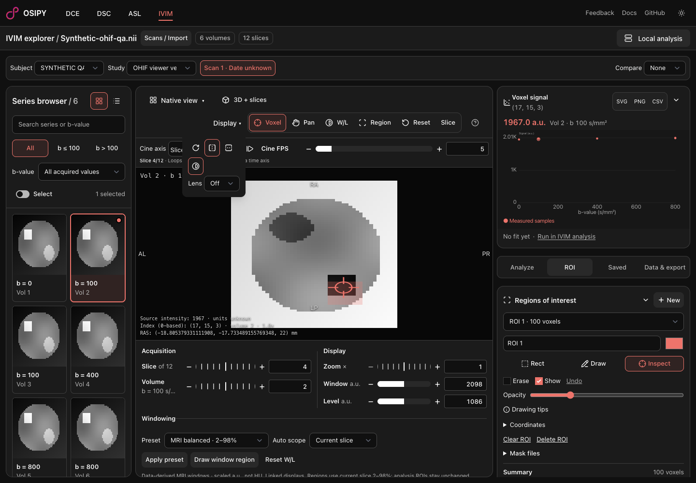
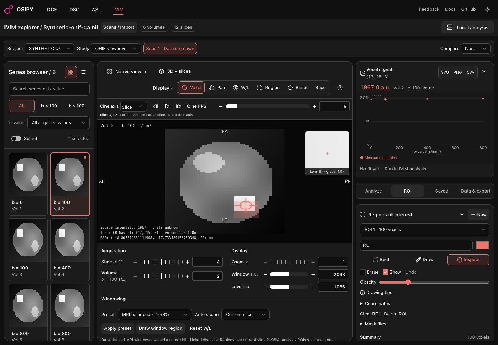
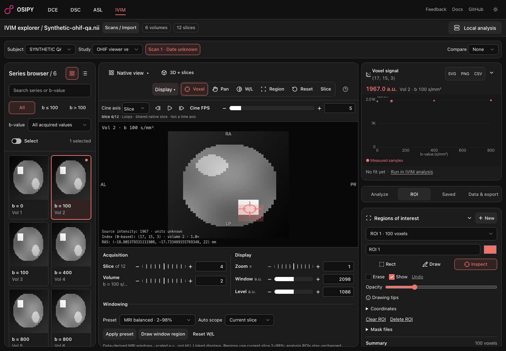
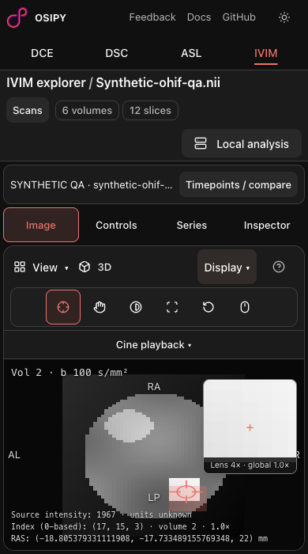

# OHIF-04 / OHIF-05 / OHIF-06: display and pixel inspection

Related to #23. Stacked on the windowing PR: transforms, ROI drawing, regional windowing, magnification and probing must share native/display coordinate mapping. No OHIF React components or new dependencies were introduced. Screenshots use the synthetic, non-patient geometry described in the OHIF-07 receipt.

## Executed acceptance

Configured headless Playwright MCP against local Vite:

- All 16 combinations of four rotations and two native-axis flips correctly selected source voxel (17, 15). Each case first moved the selection with the keyboard, avoiding a no-op selection false positive.
- The rendered image bounding-box aspect stayed 128/144 or its reciprocal for the anisotropic fixture. Affine-derived multi-letter orientation labels retain obliquity.
- Source voxel (17, 15, 3), volume 2 reports intensity 1967 and RAS coordinates (-18.805379331111908, -17.733489155769348, 22) mm. An independent read of the NIfTI bytes and affine verified both. Unknown intensity units are explicitly labelled, not guessed.
- Rotation, flips and grayscale inversion did not change this probe value. Canvas grayscale readback outside the ROI changed from 138 to 117 (sum 255); inversion is separate from overlay colors.
- A rotated/flipped rectangle created exactly 100 analysis-ROI voxels. Drawing the corresponding regional window left that ROI at 100 and still produced independently verified W=1896/L=1075.
- Workspace JSON exported rotation/flips; after Reset, a real file import and confirmation restored `rotate(270deg) scale(-1, -1)`.
- The source-only lens displays explicit local/global magnification and remains distinct from the global image and ROI overlay. Lens sizes and offsets are bounded by the viewport.
- 390 × 700 and 320 × 568 have no document overflow. Mobile transform controls, cine expansion/stepping/pause-on-collapse and Controls → Draw window region → Image were exercised. Compact toolbar and collapsed-by-default mobile cine preserve image space.

## Final integrated quality gates

From `frontend/`, after the final application edits:

- `bun run check`: zero errors/warnings.
- `bun run build`: passed; nonfatal Node deprecation and existing large-chunk warnings.
- `bun test`: 54 passed, zero failed, 627 assertions across 11 files.
- Focused Prettier and ESLint across all 15 changed frontend source files: passed.
- Staged diff/whitespace and proportionate security review: local-only data handling, bounded state/geometry, validated imported display fields, observer/timer cleanup, no new network endpoints/dependencies/credentials or private screenshot data. No major issue found.

These are browser-emulated desktop/mobile checks, not physical-device or clinical validation. The optional local analysis service was not started; its refused health request is baseline behavior. Screenshots and direct browser acceptance are evidence for this run, not a newly delivered automated E2E harness.

