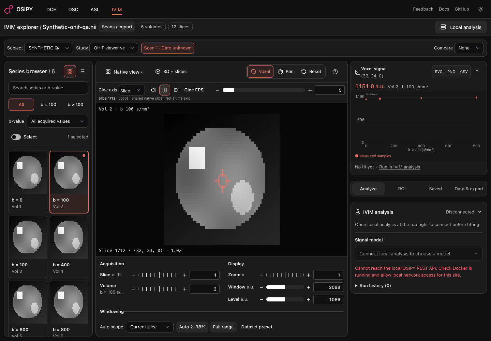
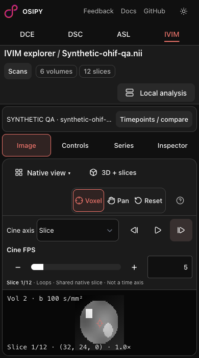

# OHIF-07: cine playback

Related to OSIPI/dashboard#23 (OHIF-07). Screenshots use an explicitly synthetic, asymmetric NIfTI geometry fixture, not patient imaging. It has 64 × 48 × 12 × 6 samples, anisotropic spacing, an oblique affine, scaling `2 × raw − 3`, and b-values `0 100 100 400 800 800`.

## Executed acceptance

Configured headless Playwright MCP against the local Vite server:

- Slice next/previous updates the shared native slice and restores it correctly.
- Acquisition stepping visits all six original indices, including both b=100 and b=800 repetitions, then wraps.
- Play advances frames; pause leaves the frame stable beyond two frame periods.
- Switching technique unmounts/stops playback; returning to IVIM starts paused.
- At 320 × 568, changing to a hidden mobile workspace panel stops playback; returning starts paused.
- 390 × 700 and 320 × 568 have no document overflow. Mobile playback buttons measured 44 × 44 CSS pixels; frame stepping works.
- Timer cleanup, bounded FPS, context changes and single-next-frame scheduling inspected in the diff. Real tab-background suspension was not browser-simulated.

## Finalization commands

From `frontend/`: `bun run check` (zero diagnostics), `bun run build`, focused Prettier/ESLint on the three changed Svelte files, and `bun test scripts/workspace.test.ts scripts/ivim.test.ts scripts/layout-preferences.test.ts` (15 pass, zero fail). `git diff --check` passed. Build has nonfatal Node deprecation and bundle-size warnings. No analysis backend was started; the existing disconnected-backend message is unrelated to viewing/playback.

